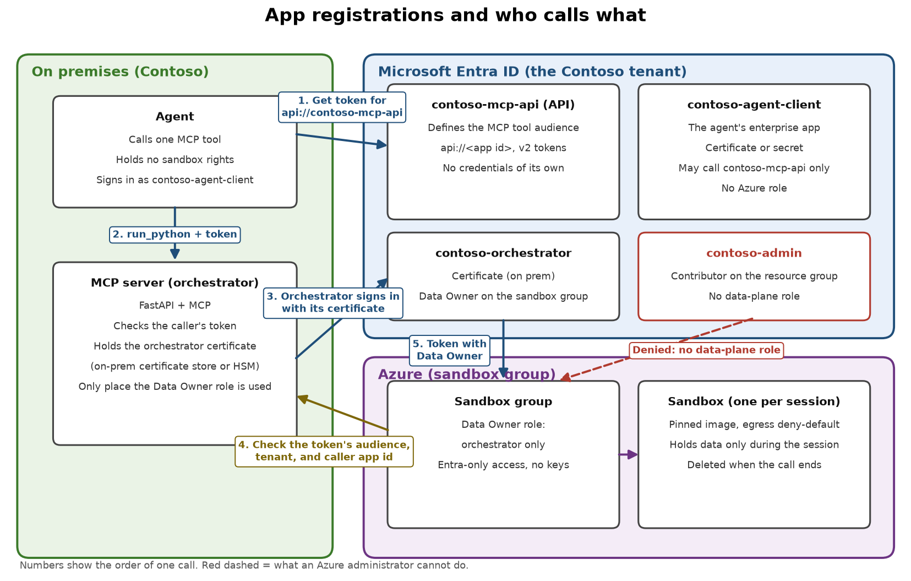

# ACA Sandboxes Approach for Contoso

Goal: meet the technology-neutral requirements in `system-requirements.md`
using Azure Container Apps Sandboxes (`Microsoft.App/sandboxGroups`, preview).

Live evidence: `demo\notebooks\` has one executed Jupyter notebook per
requirement (01 to 25), each showing how that requirement is met, with saved
output. `demo\run_all.ps1` runs the four command-line demos.

**How to read this document.** Section headings have no numbers. Numbers appear
only when they refer to a requirement (1 to 25), as listed in
`system-requirements.md`. Where a section is about one requirement, its title
says so, for example "Requirement 1".

| Section | What it covers |
|---|---|
| Trust model | Who we trust and what we cannot prove. Read this first. |
| Core control | The one rule that keeps administrators out of sandboxes. |
| Design | How a session works, start to finish. |
| How agents call this | Agents reach the sandbox only through an MCP tool backed by the orchestrator. |
| Requirement 1 | Why administrators cannot read the data, and where that stops holding. |
| Requirement 3 | How we detect tampering. |
| Requirement 4 | How we check we are talking to the right software. |
| Fit summary | All 25 requirements: how we meet each (in plain English), and how well. |
| Validation tests | The tests that prove the controls work. |
| Alternative considered | Why Foundry Code Interpreter was not chosen. |
| Live demo results | What was run and what happened. |

## Trust model (needs the customer's explicit acceptance)

**What is actually required.** The usual way to get this kind of protection is
confidential computing (special hardware that even the cloud provider cannot see
into). But the real goal is simpler: *an Azure administrator must not be able to
see the data or the logs of an agent session.* This approach meets that goal
with access controls and checks, not with special hardware. The customer needs
to agree that this is good enough.

**Who we trust, and who we do not.**

| Who | Trusted? | Why it matters |
|---|---|---|
| Azure administrators (people who manage the subscription or the app's Azure resources) | **No** | These are the people the design keeps out. They can create and delete sandboxes but cannot open one to see inside. |
| The calling application (orchestrator) | **Yes** | It is the only thing allowed to open sandboxes and handle the data. |
| A separate security team ("security authority") | **Yes** | Owns who gets which Azure permissions, the policies, and the log settings. It must be a different group from the administrators above, or the protection is meaningless. |
| Microsoft's own platform staff | **Yes** | We rely on Microsoft's normal controls. Nothing here lets us prove Microsoft cannot look. |

**What this approach cannot prove.** Requirements 3 and 4 ask us to *prove* the
environment has not been tampered with and is running the right software. With
confidential computing, hardware provides that proof. Sandboxes have no such
proof that a customer can check. Instead, we prevent tampering with permissions
and have the calling application check the sandbox's settings and image before
sending any data. That is a strong check, but it trusts Azure to answer
honestly, which is not the same as hardware proof. This is the main thing to
confirm with Contoso.

## Core control: no data-plane rights for administrators

Azure splits access to sandboxes into two separate layers, and this design keeps
administrators in only one of them.

**Layer 1: managing the sandbox group (the "control plane").** This is the
Azure Resource Manager side: creating, changing and deleting the sandbox group
itself, and setting up its network connections. Administrators work here.
It lets you set things up, but it does not let you look inside a sandbox.

**Layer 2: using the sandboxes (the "data plane").** This is everything that
touches a running sandbox: creating sandboxes, running commands, reading and
writing files, ports, network rules, secrets, snapshots and disk images. To do
anything here you need one Azure role,
**Container Apps SandboxGroup Data Owner**. There are no passwords or access
keys. You must sign in with an Entra identity that holds that role.

**The core control is simple: only the calling application holds the Data Owner
role.** Administrators do not, so they can manage the group but cannot see into
a sandbox.

| Who | What they can do |
|---|---|
| Azure and subscription administrators | Layer 1 only. They do not have Data Owner, so they cannot open sandboxes. They are also blocked from granting it to themselves (see the Requirement 1 section). |
| The calling application (orchestrator) | The only identity with Data Owner, limited to the one dedicated sandbox group. It signs in with a certificate, not a password. |
| The security authority | Decides who gets which Azure roles, and owns the policies and log settings. This is a separate team from the administrators. |

## Design

1. **Orchestrator:** the calling app (a tool used by on-premises agents, not
   required to run on-premises) authenticates and authorizes the user
   (req 6), then uses its service principal to create one sandbox per session
   in a dedicated sandbox group (13, 15, 16).
2. **Storage:** the sandbox's local disk only. No Blob or Data Disk volumes.
   Deleting the sandbox deletes the data, so there is no separate volume
   lifecycle (14, 15).
3. **Lifecycle:** suspend and snapshots disabled, so no memory or disk state
   persists. Any failure deletes the sandbox. A cleanup job deletes orphans by
   label (14, 15, 16).
4. **Network:** deny-default egress with an explicit allow-list (20).
5. **Execution:** untrusted code runs only inside the sandbox microVM (13, 18).
   CPU, memory, and time limits come from the resource tier and orchestrator
   timeouts (19).
6. **Secrets:** no long-lived secrets in the sandbox. Per-session secrets are
   generated by the orchestrator and deleted with the sandbox (11, 12).
7. **Logging:** content-free diagnostics and orchestrator logs (23).

## How agents call this

The agent never touches the sandbox. It sees one MCP tool, and the server behind
that tool is the orchestrator.

| Piece | Role |
|---|---|
| Agent (on premises) | Calls the MCP tool, for example `run_code(session, code, files)`. Authenticates with its Entra enterprise app. Holds no sandbox rights. |
| MCP server (the orchestrator) | Runs in the trusted zone. The only identity with the Data Owner role. Creates the sandbox, sets egress, does the key exchange, runs the code, returns the result, deletes the sandbox. |
| Sandbox | Runs the code. Deleted when the session ends. |

Why not hand the sandbox to the agent as a tool:

- The Data Owner role is the core control. Anything holding it, or any code that
  can reach the sandbox with it, can bypass the in-sandbox handler.
- The agent must never see the orchestrator credential, the sandbox id, or the
  session key. Behind an MCP tool it sees only the tool's inputs and results.
- The agent's token only allows calling the tool. It does not grant access to any
  sandbox.

The MCP server can be exposed through a Foundry Toolbox or any MCP client.

Caveat: the MCP server now holds the trusted credential. It belongs in the
trusted zone, and the security authority controls who can deploy or change it.
This is the same trust assumption as the orchestrator in the trust model.

### Why host the MCP server on premises

This is the recommended placement, and it is the strongest answer to the
requirement that an Azure administrator cannot reach the data.

- **The credential never enters Azure.** The orchestrator's certificate stays in
  Contoso's on-premises certificate store or HSM. An Azure administrator cannot
  list it, export it, or read it from app configuration, because it is not
  stored in Azure.
- **No hosting service for an administrator to attack.** A Container App can be
  exec'd into, have its secrets listed, or have its identity changed by anyone
  with enough Azure rights. On premises, those Azure rights do not apply.
- **It works without managed identities.** Contoso cannot use them yet. A
  certificate-based service principal needs no managed identity, and Key Vault
  references (which would need one) are not required.
- **Contoso already controls the trust zone.** The agent is on premises, so the
  call from agent to MCP server stays inside Contoso's network. Contoso's own change
  control, patching, and access rules decide who can touch it.
- **Sessions are still ephemeral.** The server only starts and stops sandboxes in
  Azure. The data is encrypted before it leaves, and it only exists in the
  sandbox for the length of the session.

What this changes about the trust model: on-premises administrators of that
server become trusted, in place of Azure administrators. That is the intended
split, because Contoso already trusts its own infrastructure team.

What is still needed:

- Outbound HTTPS from the server to the sandbox service (Azure Resource Manager
  and the regional sandbox data-plane endpoint). No inbound access from Azure.
- Conditional Access for workload identities on the service principal, limited
  to Contoso's on-premises IP ranges. A stolen certificate then cannot be used from
  elsewhere.
- Certificate rotation, and an alert on any sign-in by the service principal.
- Entra token validation on the MCP endpoint, so only the agent's enterprise app
  can call the tool.

Working code is in `mcp_server\` (FastAPI and the MCP Python SDK). Set
`ORCHESTRATOR_CERT_PATH` to use the certificate.

How the identities fit together (app registrations, token checks, and setup
commands) is explained in `app-registrations.md`. The diagram below shows the
flow.

## Requirement 1: administrator confidentiality

Requirement 1 holds only for identities that cannot assign roles on the sandbox
group's scope. It is a governance property, not a technical lock: anyone who can
assign roles there (Owner, User Access Administrator, Global Administrator
elevation) can grant themselves Data Owner and read everything. Demo 1 shows this
split: `sp-contoso-admin` is denied and cannot self-grant, while an Owner could.

- Admins hold no data-plane role, so they cannot exec, read files, change
  egress, expose ports, or snapshot.
- **Separate ownership.** Put the sandbox group in a scope (subscription or
  management group) owned by the security authority. Workload admins get
  Contributor and Role Based Access Control Administrator with an allow-list
  condition (for example Reader only), and never Owner or User Access
  Administrator. An allow-list is safer than a deny-list because new roles are
  blocked by default.
- **Elevation paths.** Control Global Administrator "elevate access". Use PIM
  with approval and alerting for any Owner-level role, and do not make workload
  admins eligible for Owner or Data Owner. For people, use role-assignable Entra
  groups whose membership only the security authority can change.
- **Detection.** Every role assignment is written to the Activity Log (demo: 10
  writes). Alert on any Data Owner assignment on the group.
- **Orchestrator check.** Before each session, read back who holds Data Owner on
  the group and fail closed on any unapproved principal, as with the image
  read-back. This narrows but does not close the window: a principal could grant,
  read, and revoke during a session.
- Protect the orchestrator credential. Use a certificate or workload identity
  federation rather than a secret, restrict sign-in with conditional access, and
  keep it off Azure-administered systems.
- Admin disruption (stop, delete) causes failure, not disclosure (req 5).

Whether an admin can reach the data therefore depends on who holds role
assignment rights over the scope. That is a decision for Contoso's security team and
is part of the trust model above.

## Requirement 3: tamper resistance

**Prevent**
- Image, egress, port, snapshot, and exec changes are data-plane operations, so
  admins without Data Owner cannot alter a running sandbox.
- Control-plane changes that could still matter: managed identity assignment,
  VNet connections, diagnostic settings. Restrict
  `Microsoft.App/sandboxGroups/write` to the security authority. Add Azure
  Policy deny rules, resource locks, and activity-log alerts on group changes.

**Verify before releasing data**
- Create each sandbox from a disk image pinned by digest, built through a
  protected pipeline.
- Read the sandbox back over the data plane and check image or disk ID, egress
  policy, ports, labels, and identity. Optionally exec a hash of the root
  filesystem.
- On any mismatch, delete the sandbox and fail.

**Limit:** checks are platform-reported, not attested. A Microsoft-level
compromise is out of scope under the narrowed trust model.

## Requirement 4: verified execution identity

Not met with hardware attestation. Met by image-based verification, with trust
rooted in the pinned image digest, Entra, and the platform (not hardware).

- **Known start state:** no snapshots, suspend, volumes, or resume. Every
  session starts from the pinned image, so nothing carries over between sessions.
- **Wipe after session:** the sandbox is deleted on completion or failure, which
  discards its local disk and secrets. Failure or restart ends the session (14).
- **Verification before release:** the orchestrator reads back the image digest
  and config (see Requirement 3). The in-sandbox service may also return a report
  (version, file hashes, orchestrator nonce) signed with a key generated at
  startup. The orchestrator checks it against expected values.
- **Run state:** session data changes the disk during a session by design.
  Untrusted Python runs in a separate restricted worker (18) so the interpreter
  service stays unmodified.
- **Accepted by Contoso:** the trust root is the platform API and Entra, not
  hardware. Deletion wiping the disk is unverified (validation test 6).

## Fit summary

Assumes the full design: no data-plane rights for admins, local disk only, no
snapshots, pinned images, and app-layer encryption.

| # | Requirement | Covered by | Fit | Evidence and gap |
|---|---|---|---|---|
| 1 | Administrator confidentiality | Both | Demonstrated | Demo 1: admin 403 on data plane, Data Owner self-grant blocked. Gap: tenant-level elevation; Contoso accepts narrowed trust model |
| 2 | Plaintext boundary | Both | Strong | Demo 2: only ciphertext uploaded; plaintext only in caller and sandbox |
| 3 | Tamper resistance | Both | Good | Demo 3: config read back and verified before release. Gap: control-plane policy and locks |
| 4 | Verified execution identity | Both | Good | Demo 3: resolved image id checked, fails closed. Platform trust root, not hardware |
| 5 | Availability attacks | Caller | Strong | Caller fails closed |
| 6 | User authorization | Caller | Strong | Calling application's job |
| 7 | Least-privilege identity | Both | Demonstrated | Orchestrator holds only Data Owner on one group. Data Owner is the only documented data-plane role |
| 8 | Restricted access | Sandbox | Good | Entra-only data plane, no public ports; add conditional access |
| 9 | Protected communications | Both | Demonstrated | Demo 2: platform TLS plus app-layer encryption |
| 10 | Session-specific authorization | Caller | Demonstrated | Demo 4: replay, tamper, wrong session, wrong key rejected. Limit: raw exec by a Data Owner holder bypasses it |
| 11 | Ephemeral secrets | Caller | Demonstrated | Demo 2 and 4: fresh key per session; not platform-enforced |
| 12 | Secret residency | Caller | Good | Key lives only in the session's sandbox and orchestrator memory; wipe indirectly shown |
| 13 | Session isolation | Sandbox | Demonstrated | Demo 3: file in session a not visible in session b |
| 14 | No recovery | Both | Demonstrated | Demo 3: suspend off, created from disk not snapshot; orchestrator starts new session on failure |
| 15 | Termination | Both | Demonstrated | Demo 2 and 3: delete leaves 0 sandboxes. Disk wipe shown indirectly only |
| 16 | Orphan cleanup | Both | Demonstrated | Demo 3: label and age sweep; auto-delete as backstop |
| 17 | Functionality | Both | Good | Exec and file read/write shown; status and health checks not shown |
| 18 | Untrusted-code isolation | Sandbox | Strong | Each sandbox is its own microVM, apart from the orchestrator |
| 19 | Resource limits | Both | Good | Platform sets CPU, memory, disk; orchestrator enforces time limit (demo 2) |
| 20 | Restricted egress | Sandbox | Demonstrated | Demo 2: 403 then 200 on allow rule; metadata endpoint unreachable |
| 21 | Temporary data | Sandbox | Good | Local disk only; wipe shown indirectly |
| 22 | Result delivery | Caller | Demonstrated | Demo 2: result returned encrypted over the session channel |
| 23 | Content-free telemetry | Both | Good | Activity Log content-free; no platform log categories; orchestrator log must be metadata-only; egress audit records URL paths |
| 24 | Immutable deployment | Both | Good | Demo 3: resolved image id pinned. Private disk image would pin Contoso's own build |
| 25 | Demonstrable enforcement | Caller | Good | Demos 1-4 cover admin denial, replay, isolation, cleanup. Not yet: restart and interruption tests |

"Covered by" key:

- **Sandbox:** the platform enforces it; the caller only configures it.
- **Caller:** the calling application (orchestrator or tool) must implement it;
  the platform provides nothing.
- **Both:** the platform provides a capability and the caller or Contoso's governance
  must configure, verify, or build on it.

"Fit" key: **Demonstrated** means shown in the live demo (`demo\run_all.ps1`).
**Strong** means met by design or platform behavior and not demoed. **Good** means
met in principle with a stated gap or an untested part.

Summary: 11 Demonstrated, 4 Strong, 10 Good, none unmet, assuming:
1. Contoso accepts the narrowed trust model (Microsoft operators trusted, no
   hardware attestation).
2. Disk wipe on delete is accepted on the indirect evidence, or verified further.
3. The orchestrator and tool logging stay metadata-only and are built correctly.

### How the approach handles each requirement, in plain language

**The idea in one paragraph.** For every request, the calling application
creates a brand-new, locked-down computer in Azure (the "sandbox"), sends it
the data in encrypted form, runs the AI's code there, gets the answer back, and
then deletes the computer. Only the calling application is allowed to open the
sandbox. Azure administrators are not, so they cannot see the data.

**Three words used below.**
- **Sandbox:** a small, throwaway computer used for one session only.
- **Calling application (orchestrator):** the trusted program that creates the
  sandbox, sends it work and deletes it.
- **Data role:** the one Azure permission ("Data Owner") that lets someone open
  a sandbox and read its files. Only the calling application has it.

Each line below says what the requirement means, then how we meet it.

| # | Requirement | In plain English | How we meet it |
|---|---|---|---|
| 1 | Administrator confidentiality | Admins must not be able to read the data. | Admins can create and delete sandboxes but are not given the data role, and they are blocked from giving it to themselves. Tested: they get "access denied". |
| 2 | Plaintext boundary | Readable data exists in as few places as possible. | Data is readable only in the calling application and inside the sandbox. Everything in between is encrypted. |
| 3 | Tamper resistance | Nobody can quietly weaken the setup. | Before sending data, the calling application checks the sandbox's settings against the approved list. Any difference means it deletes the sandbox and stops. |
| 4 | Verified execution identity | Be sure it is the right software before sending data. | The calling application checks the sandbox was built from the approved disk image. Wrong image means no data is sent. |
| 5 | Availability attacks | Admins might stop the service. That is accepted. | If a sandbox is stopped or deleted, the session fails with an error. It never falls back to something less safe. |
| 6 | User authorization | Only allowed users can start a session. | The calling application checks the user before it creates a sandbox. |
| 7 | Least-privilege identity | The application gets only the permission it needs. | Its identity has the sandbox data role on one sandbox group, and nothing else. |
| 8 | Restricted access | The sandbox is not open to the internet. | No ports are open, and access needs a signed-in Entra identity (no passwords or keys). |
| 9 | Protected communications | Traffic cannot be read or changed on the way. | Azure encrypts the connection, and the calling application also encrypts the data itself. |
| 10 | Session-specific authorization | Having network access is not enough. | Every request carries a one-time signed proof for that session. Copies, edited requests and requests for another session are rejected. |
| 11 | Unique ephemeral secrets | A new secret every session. | A fresh random key is made for each session and never reused. |
| 12 | Secret residency | Keep the secret in as few places as possible. | The key exists only in the calling application's memory and in the sandbox. It is never saved in settings, logs or databases, and it goes away with the sandbox. |
| 13 | Session isolation | One session cannot see another. | Each session has its own sandbox. Files and keys of one are invisible to the others. |
| 14 | No recovery | A failed session is never resumed. | Pause and snapshot are turned off. After any failure the sandbox is deleted and a new one starts with a new key. |
| 15 | Deterministic termination | Clean up every time. | The calling application deletes the sandbox and drops the key at the end, whether the session worked or not. |
| 16 | Orphan cleanup | Forgotten sandboxes get removed. | A cleanup job deletes old sandboxes by label and age, without looking inside. An Azure auto-delete timer is a backup. |
| 17 | Functionality | It must work as a code interpreter. | Upload, list, read and delete files, run Python, and get output, errors and health are all supported. |
| 18 | Untrusted-code separation | AI-written code cannot reach the application. | The code runs inside the sandbox, away from the calling application and its credentials. |
| 19 | Resource limits | Code cannot hog the machine. | Azure fixes CPU, memory and disk. The calling application adds a time limit and an output size limit. |
| 20 | Restricted outbound access | Code cannot call out to the internet. | All outgoing traffic is blocked unless a site is on a short approved list. |
| 21 | Protected temporary data | No lasting copies of data. | Files stay on the sandbox's own disk only and are deleted with it. |
| 22 | Direct result delivery | Results go straight back to the caller. | The result is encrypted in the sandbox and returned over the same protected channel, not stored elsewhere. |
| 23 | Content-free telemetry | Logs never contain the data. | Azure's activity log records only who did what. Our own logs record IDs and outcomes, never content. |
| 24 | Approved, immutable deployment | Only the approved image is used. | The application knows the approved image ID and refuses any other. |
| 25 | Demonstrable enforcement | Show it works. | The demos and notebooks try to break each control and show that it holds. Restart and interruption tests are still to be added. |

## Validation tests

1. With an admin holding Owner or Contributor but no Data Owner, confirm exec,
   file read, snapshot, port, and egress operations are denied.
2. Confirm whether a finer-grained data-plane role than Data Owner exists.
3. Confirm self-grant is blocked in the chosen scope design.
4. Inspect diagnostics and activity logs for content leakage.
5. Confirm snapshots and suspend can be disabled.
6. Confirm deleting a sandbox leaves no recoverable local disk data.
7. Confirm the data plane is reachable only by authenticated, approved callers
   (private connectivity is not required).
8. Confirm control-plane-only actions cannot expose data (identity assignment,
   diagnostic settings, VNet changes).

## Alternative considered: Foundry Code Interpreter

Foundry's built-in Code Interpreter runs Python in a Microsoft-managed sandbox
(ACA dynamic sessions, Hyper-V boundary per session, same region as the project,
no outbound network, up to 1 hour per session with a 30-minute idle timeout).
Source: https://learn.microsoft.com/azure/foundry/agents/how-to/tools/code-interpreter

Because Microsoft manages the sandbox, image, lifecycle, and surrounding
storage, these requirements cannot be met by us:

| # | Requirement | Fit | Reason |
|---|---|---|---|
| 1 | Administrator confidentiality | Cannot confirm | Conversation, file, and trace storage is service-managed. Admin read access unverified. |
| 2 | Plaintext boundary | Not met | Plaintext passes through the Foundry service, the model, and Foundry storage. |
| 3 | Tamper resistance | Met | Customer admins cannot modify the Microsoft-managed sandbox. Holds under the narrowed trust model (Microsoft operators trusted). |
| 4 | Verified execution identity | Partial | Entra RBAC and TLS authenticate the Foundry endpoint (platform trust root, as with sandboxes). No session-bound, replay-resistant evidence, and no in-sandbox service to add it. |
| 9 | Protected communications | Not met | No app-layer encryption to the sandbox. |
| 10 | Session-specific authorization | Not met | Project-level RBAC only. |
| 14 | No recovery | Not controllable | Platform-managed session behavior. |
| 15 | Deterministic termination | Not controllable | Platform timers (1 hour, 30-minute idle). Wipe is not verifiable. |
| 16 | Orphan cleanup | Not controllable | Platform-managed. |
| 19 | Resource limits | Not configurable | Platform-managed. |
| 21 | Protected temporary data | Cannot confirm | Storage and persistence are Microsoft-managed. |
| 23 | Content-free telemetry | Cannot confirm | Foundry tracing and logging may capture content. |
| 24 | Immutable deployment | Not met | Sandbox image is Microsoft-managed; cannot be pinned or approved. |
| 25 | Demonstrable enforcement | Weak | Cannot prove controls we do not own. |

Met: 3 (customer admins cannot modify the managed sandbox), 13 and 18 (Hyper-V
isolation), 20 (no outbound network), 6 and 7 (Entra RBAC, project level).

Conclusion: Foundry Code Interpreter is not a fit as the interpreter. Foundry can
still host the agent and call a sandbox-based interpreter as a tool (Toolbox MCP
endpoint), but any data sent through Foundry is plaintext inside Foundry, which
conflicts with requirement 2.

## Live demo results

Run with `demo\run_all.ps1` (eastus2, sandbox group `sg-contoso-demo`). Two service
principals stand in for people: `sp-contoso-orchestrator` (Data Owner on the group)
and `sp-contoso-admin` (Contributor on the resource group plus Role Based Access
Control Administrator, limited by an allow-list condition to the Reader role).
The demo user's own subscription-level Data Owner assignment was also removed;
that user still holds Owner and User Access Administrator, so cannot be used to
show self-grant prevention.

| Demo | What it shows | Result |
|---|---|---|
| 1 | Admin reads the group on the control plane | HTTP 200 |
| 1 | Admin lists sandboxes on the data plane | HTTP 403 |
| 1 | Admin assigns itself Reader / Data Owner | 201 created / 403 AuthorizationFailed |
| 2 | Egress deny-default, read back; example.com blocked then allowed | 403 then 200 |
| 2 | App-layer encryption (ECDH between a sandbox key pair and an orchestrator ephemeral key derives a per-session AES-256 key) | Round trip succeeded, ciphertext only uploaded |
| 2 | Delete, then confirm nothing remains for the session label | 0 left |
| 3 | Pin check of the resolved disk image id, no snapshot, deny egress, no ports, suspend off, auto-delete on | Pass; wrong expected id fails closed |
| 3 | Secret in one session invisible in another; new session from same disk has no old file | Pass |
| 3 | Orphan sweep by label and age only | 0 left |

Findings and caveats:

- The SDK retries a 403 for a long time, so the admin denial is shown with direct
  REST calls.
- Pinning is by read-back of the resolved platform image id. `disk_id` accepts
  only private disks.
- Self-grant prevention covers the admin identity only. Any principal with an
  unconditioned Owner, User Access Administrator, or Global Administrator
  elevation can still grant itself Data Owner, so the group's scope must be owned
  by a separate security authority.
- The egress decisions audit lags by about 30 seconds, then correctly lists
  allowed and denied hosts. It records host, method, and path, so keep sensitive
  names out of URLs and use host-level allow rules.
- Logging (23): the resource group Activity Log holds control-plane events only
  (role assignments, group writes) and contained none of the demo content. The
  sandbox group exposes only a Basic metrics diagnostic category and no log
  categories. Data-plane operations do not appear in the Activity Log, so there is
  also no administrator-visible audit of data-plane access; if Contoso wants one,
  it must come from the orchestrator's own metadata-only log.
- Separation (18): each sandbox is its own microVM, isolated from the sandbox
  group, other sandboxes, and the orchestrator. The orchestrator and its
  credentials run outside every sandbox, so AI-generated code cannot reach them.
  The per-session key lives only in that session's sandbox, which is the intended
  plaintext boundary for that one session.
- Also shown in demo 2: the cloud metadata endpoint (169.254.169.254) is
  unreachable under deny-default egress; a runaway process is stopped by a time
  limit applied by the orchestrator (`timeout`, not a platform setting); the
  encryption now uses a random nonce per message and binds the session id as AAD.
- Per-operation session authentication (10), demo 4: each operation carries an
  HMAC token bound to the session id, a counter, and the request body, checked by
  a handler in the sandbox. Valid requests pass; replay, tampered body, missing
  token, wrong session id, and wrong key are rejected. This binds operations to
  one session and one caller, but a Data Owner holder can still bypass the
  handler with raw exec, so the no-data-plane-rights control remains the real
  gate. In production the handler would be baked into the approved disk image and
  called only by the interpreter tool (for example an MCP endpoint in a Foundry
  Toolbox) that holds the orchestrator identity; the agent never sees the key or
  sandbox id.
- Plain-language explanation of key establishment is in `system-requirements.md`
  (Key establishment). In short: the sandbox and orchestrator each hold a private
  key, swap only public keys, and both compute the same session key. The key is
  never sent over the wire.
- The demo derives a per-session AES-256 key with ECDH (X25519 + HKDF-SHA256)
  between a key pair the sandbox generates and an ephemeral orchestrator key, so
  the key is never sent. HPKE is the standardized form of the same idea; the demo
  uses ECDH because the sandbox has no outbound access to install an HPKE library.
  Production would add attestation to bind the key to the environment.
- Demo secrets are client secrets in `demo\sp-*.json`. Production should use a
  certificate or workload identity federation.
